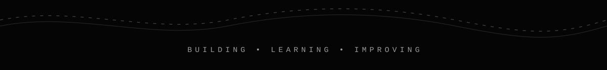

<div align="center">


<a href="https://github.com/shreyanshmisra1027">
  
</a>

</div>


## About

B.Tech Computer Science and Engineering (Cybersecurity) student at **VIT Chennai**, graduating in **2030**.

I'm interested in software engineering, systems programming, and security, and I'm working through computer science fundamentals one layer at a time. I'd rather understand something properly from first principles than copy solutions quickly.

```python
class Developer:
    def __init__(self):
        self.name = "Shreyansh Misra"
        self.education = "B.Tech CSE - Cybersecurity"
        self.interests = [
            "Software Engineering",
            "Systems Programming",
            "Cybersecurity",
            "Open Source",
        ]
        self.currently_learning = [
            "Python",
            "C/C++",
            "Java",
            "Data Structures and Algorithms",
            "Linux",
        ]

    def philosophy(self):
        return "Understand deeply. Build relentlessly."
```


## Currently exploring

| Area | Focus |
| :-- | :-- |
| Data Structures and Algorithms | Problem solving and algorithm implementation |
| C / C++ | Systems programming and memory management fundamentals |
| Python | Development, scripting, and tooling |
| Java | Object-oriented programming principles |
| Linux | Command-line environment and system administration |
| Cybersecurity | Security foundations and network principles |
| Software engineering | Version control, clean architecture, and best practices |


## Technology stack

Tools I use or am actively studying. This is a practical overview of my learning stack, not a claim of professional proficiency.

**Languages**  


**Development tools**  


**Systems**  


## Selected projects

| Repository | What it is | Language |
| :-- | :-- | :-- |
| [**CrankView**](https://github.com/shreyanshmisra1027/CrankView) | Interactive 3D four-stroke engine simulator and thermodynamics laboratory | TypeScript |
| [**Personal-Portfolio**](https://github.com/shreyanshmisra1027/Personal-Portfolio) | Personal engineering portfolio site featuring interactive 3D WebGL visuals | TypeScript |
| [**hackverse-sprint3**](https://github.com/shreyanshmisra1027/hackverse-sprint3) | *ineVITable*: private two-person communication app using WebRTC data channels | TypeScript |
| [**shreyanshmisra1027.github.io**](https://github.com/shreyanshmisra1027/shreyanshmisra1027.github.io) | Personal GitHub Pages developer landing page | CSS |


## GitHub statistics

<div align="center">


</div>


## Connect

- **GitHub**: [github.com/shreyanshmisra1027](https://github.com/shreyanshmisra1027)
- **LinkedIn**: *Placeholder — update once profile URL is available*


